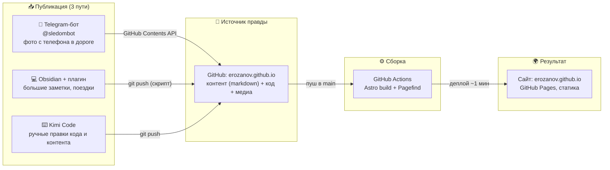
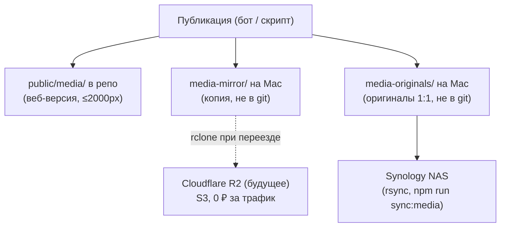
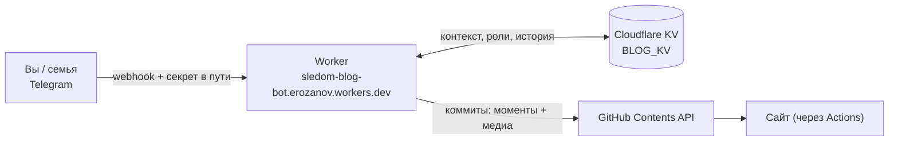
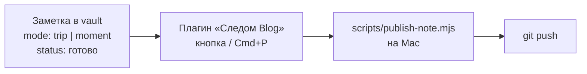
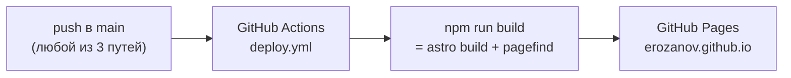

# Архитектура блога «Следом»

Полная схема системы: как контент попадает из Telegram и Obsidian на сайт,
где что хранится и как это всё обновляется. Документ актуален на ноябрь 2026.

---

## 1. Общая картина

Система состоит из четырёх независимых слоёв. Ключевой принцип:
**единственный источник правды — git-репозиторий**, всё остальное —
сменные детали вокруг него.



---

## 2. Слой контента (git-репозиторий)

### Модель данных

Две коллекции (`src/content/`):

**Поездка** (`trips/<id>.md`) — создаётся один раз:

```yaml
title, country, number, startDate, endDate, summary
cover, coverAlt
cities:                    # у каждого города:
  - name, slug, tagline
    image, imageAlt
    coordinates: { lat, lng }   # для карты Leaflet
```

**Момент** (`moments/<id>.md`) — одна заметка. Четыре типа
определяются содержимым, отдельного поля «тип» нет:

| Тип | Признак |
|---|---|
| Фото + заметка | `media:` с фото + текст |
| Фото без заметки | `media:` + пустое тело |
| Видео + заметка | `media:` с `type: video` (+`poster`) + текст |
| Просто текст | без `media:` (или `media: []`) |

```yaml
media:
  - type: photo | video
    src: "china/sanya/china-20261013-01.jpg"   # ← логический ключ, БЕЗ хоста
    alt, poster?, best?                        # best → «Лучшие кадры»
```

### Ключи медиа без хоста

В контенте хранится только путь (`china/sanya/file.jpg`). Хост подставляется
при сборке переменной `MEDIA_BASE_URL` (`src/utils/media.ts`):
по умолчанию `/media/…` (файлы из `public/media/` в репозитории).
Переезд медиа к любому хостеру = смена одной переменной, контент не трогаем.

---

## 3. Слой медиа (3-2-1)



- **Веб-версии** — в репозитории (сейчас) или в R2 (после переезда);
- **Оригиналы** — только локально и на NAS, в git никогда;
- **Synology** — внешняя копия всего архива.

---

## 4. Слой публикации

### 4a. Telegram-бот (Cloudflare Worker)



**Что умеет:** команды `/trip` `/city` `/date` `/status` `/trips`;
публикация фото/видео/текста; альбомы (склейка через KV, 5 сек);
хэштеги → теги; ⭐ → best; `/delete`; редактирование ответом на
сообщение бота; роли.

**Ключи в KV (`BLOG_KV`):**

| Ключ | Содержимое | TTL |
|---|---|---|
| `roles` | `{userId: admin\|editor\|guest}` | — |
| `ctx:<chatId>` | активные поездка/город/дата | — |
| `history:<chatId>` | последние 20 постов (для /delete и правок) | — |
| `trips-cache` | список поездок из репо | 1 час |
| `album:<id>` | буфер склейки альбома | 1 час |
| `pending:<id>` | пост guest на модерации | 24 часа |

**Роли:** admin — всё + `/role`; editor — публикация, `/delete`, правки;
guest — посты приходят админу с кнопками ✅/❌. Владелец
(`TELEGRAM_ALLOWED_USER_ID`) — всегда admin (bootstrap).

**Секреты** (Cloudflare Secrets, не в git): токен бота, ID владельца,
GitHub PAT (Contents RW на один репо), секрет webhook.
Локально — `bot/.dev.vars` (gitignored).

### 4b. Obsidian (десктопный путь)



- `mode: trip` — создаёт поездку целиком (города с координатами из блока
  ```` ```cities ````);
- `mode: moment` — момент с фото из vault;
- фото сжимаются `sips` до 2000px, оригиналы — в `media-originals/`;
- лимита на размер файла нет (в отличие от Telegram);
- формат — в `PUBLISHING.md`.

### 4c. Kimi Code (ручной путь)

Любые правки кода и контента через агента; публикация — обычный
`git commit && git push`. Удалённо с телефона — Kimi Code Remote Control
(`kimi rc` на Mac → ссылка/QR → сессия в браузере телефона).

---

## 5. Слой сайта

**Astro 7, статика, без фреймворков.** Plain CSS с дизайн-токенами
(холодная сине-серая палитра), шрифты Onest + Playfair Display.

**Страницы:**

| Путь | Что |
|---|---|
| `/` | архив по годам, календарь, темы, «Лучшие кадры» (Pinterest-лента) |
| `/trips/<id>/` | поездка: хиро, главы городов, моменты, статистика, карта |
| `/map/` | Leaflet-карта всех городов (тайлы OSM) |
| `/tags/<тег>/` | подборки по темам |
| `/search/` | Pagefind (статический индекс, строится при деплое) |
| `/about/`, `/404` | о проекте, ошибка |

**Интерактив (ванильный JS в компонентах):** галерея-лайтбокс
(`GalleryDialog` — листает моменты любых типов, стрелки/клавиатура/свайп),
карты Leaflet, фильтры архива/календаря/тем.

**SEO:** Open Graph на каждой странице, sitemap, robots.txt,
canonical — домен задаётся в `astro.config.mjs` (`site`).

---

## 6. Слой сборки и деплоя



- Node 24, кэш npm, ~40–60 секунд на деплой;
- одновременные пуши отменяют предыдущий билд (concurrency);
- хостинг бесплатный, без лимита трафика.

---

## 7. Безопасность

| Что | Где лежит | Кто видит |
|---|---|---|
| Контент, код | GitHub (пока public!) | все — до переезда в private |
| Токен бота, PAT, секреты Worker | Cloudflare Secrets | только Worker |
| `.dev.vars` (те же секреты локально) | Mac, gitignored | только вы |
| Оригиналы фото | Mac + Synology | только вы |
| Бот | белый список ролей + секрет в webhook-пути | только семья |

**До публикации реальных семейных фото:** перевести репозиторий в private
и перенести хостинг на Cloudflare Pages (там private-репо бесплатен),
сайт закрыть Cloudflare Access (вход по email, до 50 человек бесплатно).

---

## 8. Лимиты (бесплатные тарифы)

| Сервис | Лимит | Потребление |
|---|---|---|
| Workers | 100k запросов/день | ~1 на сообщение бота |
| KV | 100k чтений, 1k записей/день | единицы–десятки |
| R2 (будущее) | 10 ГБ, трафик 0 ₽ | архив на годы |
| GitHub Pages | без лимита трафика | — |
| GitHub Actions | 2000 мин/мес | ~1 мин на деплой |
| Telegram Bot API | 20 МБ на файл | большие файлы → через Obsidian |

---

## 9. Дорожная карта

- [x] Сайт, галереи, карты, поиск, теги
- [x] Пайплайн Obsidian (поездки + моменты)
- [x] Telegram-бот (публикация, альбомы, роли, модерация, /delete, правки)
- [ ] Приватный репозиторий + Cloudflare Pages + Access
- [ ] Медиа в R2 (репо разгрузится, `MEDIA_BASE_URL` уже готов)
- [ ] 360°-панорамы Insta360 (Photo Sphere Viewer, тип `pano`)
- [ ] Watcher на Mac (автопубликация из папки vault)
- [ ] Локальный Bot API сервер (файлы до 2 ГБ через бота)

---

## 10. Карта репозитория

```
├── src/
│   ├── content/          # trips/ + moments/ — весь контент
│   ├── components/       # GalleryDialog, MomentEntry, TravelMap, …
│   ├── pages/            # маршруты сайта
│   ├── layouts/          # BaseLayout (OG, мета)
│   ├── styles/           # global.css (дизайн-токены)
│   └── utils/            # dates, media (mediaSrc)
├── public/media/         # веб-версии фото (в git)
├── scripts/
│   ├── publish-note.mjs  # публикация из Obsidian
│   └── sync-media.mjs    # бэкап на NAS / облако
├── bot/                  # Telegram-бот (Cloudflare Worker)
├── obsidian-plugin/      # плагин для Obsidian
├── .github/workflows/    # deploy.yml
├── PIPELINE.md           # пайплайн публикации (детально)
├── PUBLISHING.md         # формат заметок для публикации
├── TELEGRAM_BOT.md       # спецификация бота
└── ARCHITECTURE.md       # этот файл
```
