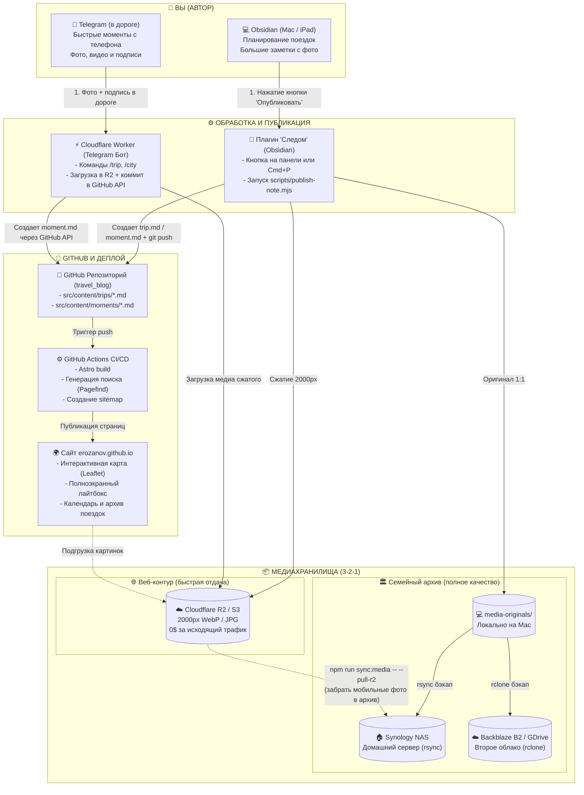
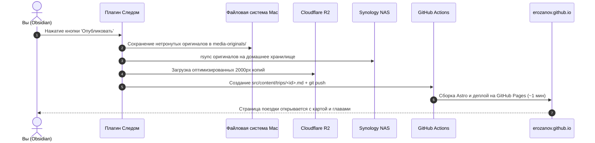
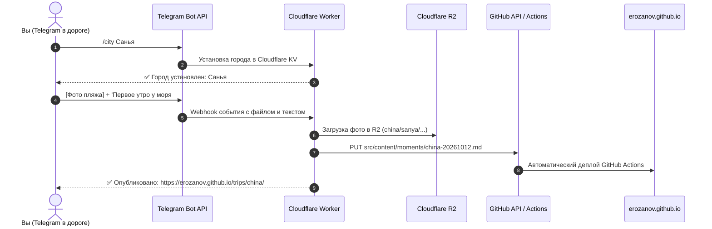

# Полная архитектура и пайплайн блога «Следом»

Этот документ наглядно описывает, как устроена вся система: планирование в **Obsidian**, мобильные публикации через **Telegram**, многоуровневое хранилище медиа и автоматический деплой на сайт.

---

## 🗺️ Общая визуальная схема системы



---

## 🧭 Пользовательские сценарии (User Journey)

### Сценарий 1: Планирование новой поездки (Дома, Obsidian)

Когда вы планируете путешествие:

1. **Создание заметки:** В Obsidian создаёте заметку поездки (например, `Япония.md`).
2. **Шаблон:** Нажимаете `Cmd + P` → `Следом: Вставить шаблон новой поездки (mode: trip)`.
3. **Заполнение:**
   - Пишете даты, общую концепцию, номер и страну.
   - В блоке ` ```cities ` перечисляете города маршрута, их координаты (для карты) и короткие фразы-тэглайны.
   - Рядом с заметкой в Vault кладёте обложку и фото для городов.
4. **Публикация:** Нажимаете иконку **компаса 🧭** в панели слева (или `Cmd + P` → `Следом: Опубликовать`).
5. **Что происходит под капотом:**
   - Плагин запускает `publish-note.mjs`.
   - Оригиналы фото сохраняются в домашний архив (`media-originals/` → Synology NAS).
   - Оптимизированные копии заливаются в Cloudflare R2.
   - Создаётся файл `src/content/trips/japan.md`.
   - Происходит `git push` → GitHub Actions пересобирает сайт.
   - Страница поездки `erozanov.github.io/trips/japan/` с картой маршрута готова!



---

### Сценарий 2: Добавление моментов в дороге (С телефона, Telegram)

Вы гуляете по городу, телефон в кармане, доставать ноутбук не нужно:

1. **Один раз задаёте контекст:**
   - `/trip china` (выбрать поездку)
   - `/city Санья` (выбрать текущий город)
2. **Публикация на ходу:**
   - Отправляете боту фото (или альбом) с подписью:  
     *«Первое утро у моря. Волны сегодня очень тихие. #море #утро»*
   - Добавите `⭐` в начале — фото станет кандидатом в «Лучшие кадры».
3. **Что происходит под капотом:**
   - Cloudflare Worker принимает хук из Telegram.
   - Скачивает фото, сохраняет в R2 с ключом `china/sanya/2026-10-12-01.jpg`.
   - Через GitHub API создаёт файл `src/content/moments/china-20261012.md`.
   - GitHub Actions автоматически собирает сайт.
   - Через минуту заметка уже видна в соответствующей главе на сайте!



---

### Сценарий 3: Редактирование и обновление поездки (Дома, Obsidian)

Если вы хотите изменить текст, поправить даты или добавить город в маршрут:

1. Открываете ту же заметку поездки в Obsidian.
2. Меняете текст или список городов в блоке ` ```cities `.
3. Нажимаете кнопку публикации 🧭.
4. Плагин видит, что поездка уже была опубликована, показывает диалог подтверждения:
   *«Обновить поездку на сайте?»* → нажимаете **Обновить**.
5. Сайт обновляется без дублирования файлов.

---

### Сценарий 4: Синхронизация архива и бэкапов (После возвращения)

Все фото, опубликованные с телефона через Telegram, попали в Cloudflare R2. Чтобы они оказались в вашем долговечном семейном архиве на Synology NAS:

1. На Mac запускаете:
   ```bash
   npm run sync:media -- --pull-r2
   ```
2. Скрипт подтягивает новые файлы из R2 в локальный архив и запускает `rsync` на Synology NAS.
3. Копия всех оригиналов хранится у вас дома, даже если вы когда-либо решите закрыть блог.

---

## 🛡️ Принципы архитектуры: Безопасность и Единый источник правды

### 1. Личный проект отделён от публичного блога
Рабочая заметка поездки в папке `Projects/2026-Китай/` содержит приватные данные: номера броней, билеты, квитанции, траты и паспортные данные.  
- **В блог она никогда не попадает напрямую.**
- Для блога создаётся лёгкая карточка в `Блог/Поездки/Китай.md` (только фото, описание и города).
- По завершении поездки проект целиком уходит в `Archive/Projects/`, а блог остаётся чистым и красивым.

### 2. Единый источник правды (Решение проблемы рассинхрона)
Когда вы публикуете момент на ходу из Telegram, он попадает на сайт через коммит в GitHub.  
- Чтобы вам **не нужно было лезть в GitHub руками** для исправления опечаток, плагин Obsidian подтягивает новые коммиты из GitHub обратно в ваш Vault.
- Вся поездка из Telegram оказывается в вашем Obsidian. Вы правите текст прямо в Obsidian и жмёте 🧭.

### 3. Редактирование прямо на сайте (Web Inline Editor)
В будущем на сайт добавляется кнопка «Редактировать» (доступная только вам после авторизации через GitHub):
- Кликаете на любой момент в браузере → правите текст → нажимаете «Сохранить».
- Браузер через GitHub API сохраняет изменения в репозиторий.
- При следующем открытии Obsidian на Mac эти правки автоматически приезжают в ваши заметки.

---

## 🗄️ Матрица хранения данных

| Хранилище | Что там хранится | Качество | Роль в системе |
|-----------|------------------|----------|----------------|
| **Cloudflare R2** | Фото и видео блога | Оптимизированное (до 2000px) | Публичная быстрая раздача читателям сайта |
| **media-originals/ (Mac)** | Все исходные кадры | 100% оригинал + EXIF | Локальный архив на рабочем компьютере |
| **Synology NAS** | Полная копия оригиналов | 100% оригинал + EXIF | Главный домашний отказоустойчивый сервер (RAID) |
| **Backblaze B2 / GDrive** | Зеркало оригиналов | 100% оригинал + EXIF | Холодная копия на случай пожара/кражи (offsite) |
| **GitHub репозиторий** | Тексты заметок, схемы, код | Markdown / Текст | Версионирование историй и код сайта |

---

## 🔗 Файлы проекта, реализующие эту схему

- **[`obsidian-plugin/`](file:///Users/erozanov/Projects/travel_blog/obsidian-plugin)** — Плагин Obsidian (кнопка, команды, диалоги).
- **[`scripts/publish-note.mjs`](file:///Users/erozanov/Projects/travel_blog/scripts/publish-note.mjs)** — Движок публикации (сжатие, раскладка оригиналов, rsync, git push).
- **[`scripts/sync-media.mjs`](file:///Users/erozanov/Projects/travel_blog/scripts/sync-media.mjs)** — Утилита синхронизации NAS, R2 и облачного бэкапа.
- **[`TELEGRAM_BOT.md`](file:///Users/erozanov/Projects/travel_blog/TELEGRAM_BOT.md)** — Спецификация и код Cloudflare Worker бота.
- **[`PUBLISHING.md`](file:///Users/erozanov/Projects/travel_blog/PUBLISHING.md)** — Справочник по форматам заметок и переменным окружения.
